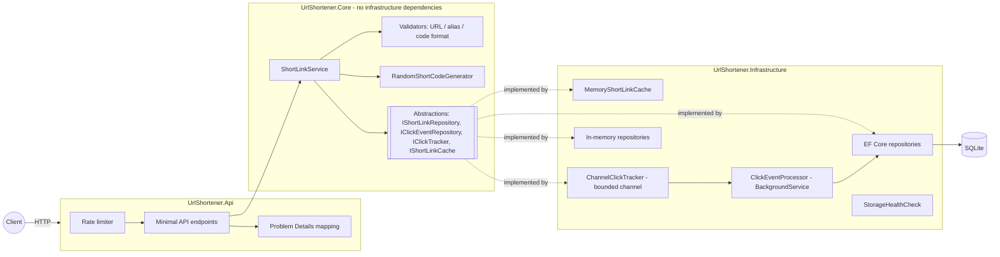

# URL Shortener Service (.NET 10)

A production-style URL shortener built with **ASP.NET Core 10 minimal APIs**, **EF Core 10 + SQLite**, and an
asynchronous click-analytics pipeline. It was built as a prototype for *AI-assisted engineering execution*: the
requirement was decomposed into tasks, implemented with AI assistance, and validated with automated quality gates,
with the engineer owning every decision.

| | |
|---|---|
| Runtime | .NET 10 (`net10.0`), C# latest |
| API | ASP.NET Core minimal APIs, OpenAPI 3 document + Swagger UI, RFC 9457 Problem Details |
| Storage | SQLite via EF Core 10 (default) or in-memory (dev/tests) |
| Reliability | Per-client rate limiting, health check, bounded async analytics queue, redirect cache, graceful shutdown drain |
| Tests | 113 tests: 84 unit (xUnit) + 29 integration (`WebApplicationFactory` + real SQLite) |

---

## Table of contents

1. [Features](#features)
2. [Quick start](#quick-start)
3. [API reference](#api-reference)
4. [Configuration](#configuration)
5. [Architecture](#architecture)
6. [Key design decisions](#key-design-decisions)
7. [Testing approach](#testing-approach)
8. [Quality gates](#quality-gates)
9. [Risks, trade-offs and failure scenarios](#risks-trade-offs-and-failure-scenarios)
10. [Assumptions and limitations](#assumptions-and-limitations)
11. [AI-assisted engineering approach](#ai-assisted-engineering-approach)
12. [Engineering summary](#engineering-summary)
13. [Repository layout](#repository-layout)

---

## Features

- **Shorten URLs** with cryptographically random 7-character Base62 codes (about 3.5 trillion combinations, not enumerable).
- **Custom aliases** (`3-32` chars of `A-Z a-z 0-9 - _`) with reserved-word protection (`api`, `health`, `openapi`, ...).
- **Optional expiry** – expired links return `410 Gone`.
- **Soft delete / deactivation** – deactivated links return `410 Gone`; codes are never reused.
- **Deduplication** – shortening the same URL again (no alias, no expiry) returns the existing link (`200 OK`).
- **Redirects** with `302 Found` + `Cache-Control: private, no-cache` so every click is counted and deactivation is immediate.
- **Analytics** – total clicks, last access time, zero-filled daily click series, top referrer hosts.
- **Privacy-aware tracking** – only the referrer *host* and a truncated user agent are stored; no IP addresses.
- **Input safety** – only absolute `http`/`https` URLs, no embedded credentials, max length, blocked hosts, and the
  service's own host is blocked to prevent redirect loops.
- **Reliability** – rate limiting (separate budgets for create vs. redirect), `/health`, bounded click queue that
  never blocks redirects, per-instance redirect cache, batch persistence, drain on shutdown.
- **Operability** – OpenAPI document at `/openapi/v1.json`, interactive Swagger UI at `/swagger`, structured logging via source-generated `LoggerMessage`,
  consistent Problem Details errors with a machine-readable `errorCode`.

---

## Quick start

### Prerequisites

- [.NET 10 SDK](https://dotnet.microsoft.com/download/dotnet/10.0) (`dotnet --version` should print `10.0.x`)
- Optional: Docker

### Run locally

```bash
git clone https://github.com/EswaraGudivada/AI_Assisted_Eswara.git
cd AI_Assisted_Eswara
dotnet restore
dotnet run --project src/UrlShortener.Api
# API listening on http://localhost:5213
```

The SQLite database (`urlshortener.db`) is created automatically in the working directory on first start.
To run without a database file use the in-memory provider:

```bash
dotnet run --project src/UrlShortener.Api -- --Storage:Provider=InMemory
```

### Run with Docker

```bash
docker build -t urlshortener .
docker run --rm -p 8080:8080 -v urlshortener-data:/data \
  -e Shortener__BaseUrl=http://localhost:8080 urlshortener
```

### Try it

```bash
# Create a short link
curl -s -X POST http://localhost:5213/api/links \
  -H "Content-Type: application/json" \
  -d '{"url":"https://learn.microsoft.com/dotnet/","customAlias":"dotnet-docs"}'

# Follow it (302 redirect)
curl -i http://localhost:5213/dotnet-docs

# Analytics for the last 7 days
curl -s "http://localhost:5213/api/links/dotnet-docs/stats?days=7"

# Deactivate it (subsequent redirects return 410)
curl -i -X DELETE http://localhost:5213/api/links/dotnet-docs

# Health and OpenAPI
curl http://localhost:5213/health
curl http://localhost:5213/openapi/v1.json
```

Open **http://localhost:5213/swagger** (or http://localhost:8080/swagger in Docker) to explore and call the API
interactively with Swagger UI.

### Run the tests

```bash
dotnet test                                    # all tests
dotnet test tests/UrlShortener.UnitTests       # unit tests only
dotnet test --collect:"XPlat Code Coverage"    # with coverage (Cobertura XML)
```

---

## API reference

All errors use `application/problem+json` and include an `errorCode` extension, e.g.:

```json
{
  "type": "https://tools.ietf.org/html/rfc9110#section-15.5.1",
  "title": "Bad Request",
  "status": 400,
  "detail": "Only http and https URLs are supported.",
  "errorCode": "url.invalid",
  "traceId": "00-..."
}
```

| Method | Path | Description | Success | Errors |
|---|---|---|---|---|
| `POST` | `/api/links` | Create a short link | `201` new, `200` deduplicated | `400`, `409`, `429`, `503` |
| `GET` | `/api/links?page=1&pageSize=20` | List links, newest first (`pageSize` 1-100) | `200` | `400` |
| `GET` | `/api/links/{code}` | Link metadata (includes inactive links) | `200` | `404` |
| `DELETE` | `/api/links/{code}` | Deactivate (soft delete, idempotent) | `204` | `404` |
| `GET` | `/api/links/{code}/stats?days=7` | Click analytics (`days` 1-90) | `200` | `400`, `404` |
| `GET` | `/{code}` | Redirect to the original URL | `302` | `404`, `410`, `429` |
| `GET` | `/health` | Storage health check | `200` / `503` | |
| `GET` | `/openapi/v1.json` | OpenAPI 3 document | `200` | |
| `GET` | `/swagger` | Swagger UI (interactive docs, backed by `/openapi/v1.json`) | `200` | |

### Create request

```json
{
  "url": "https://example.com/some/long/path?with=query",
  "customAlias": "spring-sale",
  "expiresAt": "2026-12-31T23:59:59Z"
}
```

Only `url` is required.

### Link response

```json
{
  "code": "spring-sale",
  "shortUrl": "https://sho.rt/spring-sale",
  "originalUrl": "https://example.com/some/long/path?with=query",
  "createdAt": "2026-10-12T22:08:31.01+00:00",
  "expiresAt": "2026-12-31T23:59:59+00:00",
  "isActive": true,
  "isCustomAlias": true,
  "clickCount": 0,
  "lastAccessedAt": null
}
```

### Statistics response

```json
{
  "code": "spring-sale",
  "totalClicks": 42,
  "lastAccessedAt": "2026-10-12T22:10:05+00:00",
  "windowDays": 3,
  "dailyClicks": [
    { "date": "2026-10-10", "clicks": 0 },
    { "date": "2026-10-11", "clicks": 17 },
    { "date": "2026-10-12", "clicks": 25 }
  ],
  "topReferrers": [
    { "referrer": "news.ycombinator.com", "clicks": 30 },
    { "referrer": "(direct)", "clicks": 12 }
  ]
}
```

### Error codes

| `errorCode` | HTTP | Meaning |
|---|---|---|
| `url.invalid` | 400 | Missing, malformed, non-http(s), credentialed, too long or blocked URL |
| `alias.invalid` | 400 | Alias has the wrong format or is reserved |
| `expiry.invalid` | 400 | `expiresAt` is not in the future |
| `paging.invalid` | 400 | `page < 1` or `pageSize` outside 1-100 |
| `stats.window_invalid` | 400 | `days` outside 1-`MaxStatsWindowDays` |
| `alias.conflict` | 409 | Custom alias already in use |
| `link.not_found` | 404 | Code does not exist |
| `link.expired` | 410 | Link passed its expiry |
| `link.deactivated` | 410 | Link was deactivated |
| `code.generation_failed` | 503 | No unique code after `MaxGenerationAttempts` (retry) |
| *(none)* | 429 | Rate limit exceeded; see `Retry-After` header |

---

## Configuration

Settings live in `src/UrlShortener.Api/appsettings.json` and can be overridden with environment variables
(`Section__Key`) or command-line arguments (`--Section:Key=value`). All option sections are validated at startup
(`ValidateOnStart`), so a bad configuration fails fast instead of at the first request.

| Key | Default | Description |
|---|---|---|
| `Shortener:BaseUrl` | *(empty)* | Public base URL for `shortUrl`. **Set in production**; when empty the request Host header is used. Its host is automatically blocked as a target. |
| `Shortener:CodeLength` | `7` | Generated code length (4-16) |
| `Shortener:MaxGenerationAttempts` | `5` | Collision retries before `503` |
| `Shortener:DeduplicateUrls` | `true` | Reuse an existing generated link for the same URL |
| `Shortener:MaxUrlLength` | `2048` | Max target URL length (32-2048) |
| `Shortener:MaxStatsWindowDays` | `90` | Max `days` for the stats endpoint |
| `Shortener:ReservedAliases` | `api, health, openapi, swagger, admin, static` | Configured values are *appended* to the defaults |
| `Shortener:BlockedHosts` | `[]` | Hosts (and their subdomains) that may not be shortened |
| `Storage:Provider` | `Sqlite` | `Sqlite` or `InMemory` |
| `Storage:ConnectionString` | `Data Source=urlshortener.db` | SQLite connection string |
| `Caching:Enabled` | `true` | Enable the redirect lookup cache |
| `Caching:TtlSeconds` | `60` | Cache entry lifetime (bounds cross-instance staleness) |
| `Caching:MaxEntries` | `10000` | Cache size limit |
| `ClickTracking:QueueCapacity` | `10000` | Bounded click buffer; events beyond it are dropped and counted |
| `ClickTracking:BatchSize` | `100` | Max events persisted per batch |
| `RateLimiting:CreatePermitsPerMinute` | `30` | Per-client-IP limit for `POST /api/links` |
| `RateLimiting:RedirectPermitsPerMinute` | `600` | Per-client-IP limit for `GET /{code}` |

---

## Architecture

### Components



| Project | Responsibility | Depends on |
|---|---|---|
| `UrlShortener.Core` | Domain model (`ShortLink`, `ClickEvent`), business rules (`ShortLinkService`), validation, code generation, `Result<T>`/`Error` types, abstractions | BCL only |
| `UrlShortener.Infrastructure` | EF Core + SQLite and in-memory repositories, redirect cache, click channel + background processor, health check, DI wiring and options validation | Core, EF Core, ASP.NET Core shared framework |
| `UrlShortener.Api` | HTTP surface: endpoints, contracts (DTOs), error mapping, rate limiting, security headers, OpenAPI | Core, Infrastructure |
| `UrlShortener.UnitTests` | Fast tests of Core and Infrastructure components with fakes and `FakeTimeProvider` | Core, Infrastructure |
| `UrlShortener.IntegrationTests` | Full HTTP pipeline via `WebApplicationFactory` (in-memory and SQLite) and SQLite repository tests | Api, Infrastructure |

### Control flow

**Create** (`POST /api/links`)

1. Rate limiter (`create` policy) admits or rejects with `429`.
2. `ShortLinkService.CreateAsync` validates/normalizes the URL, validates expiry (normalized to UTC).
3. With an alias: validate format and reserved list, then `TryAddAsync`; a duplicate yields `409`.
4. Without an alias: if deduplication applies, return the existing link (`200`); otherwise generate a code and
   `TryAddAsync`, retrying on collision up to `MaxGenerationAttempts` (the database unique index is the source of truth,
   so concurrent inserts are safe).

**Redirect** (`GET /{code}`) – the hot path

1. Rate limiter (`redirect` policy).
2. Cheap format check (no storage hit for junk such as `/favicon.ico`).
3. Cache lookup, falling back to the repository and populating the cache.
4. Active/expiry check against `TimeProvider` (`410` when gone).
5. `IClickTracker.TryTrack` writes to a bounded channel – **non-blocking**; if the buffer is full the event is dropped
   and counted, and the redirect still succeeds.
6. `302 Found` with `Cache-Control: private, no-cache`.

**Analytics persistence** (background)

`ClickEventProcessor` (single reader) waits for events, drains up to `BatchSize`, and calls
`IClickEventRepository.RecordBatchAsync`, which inserts the events and increments `ClickCount`/`LastAccessedAt` in one
transaction. Failures are logged and the loop continues. On shutdown, `StopAsync` drains whatever is still buffered.

**Statistics** read the link (authoritative total from `ClickCount`) plus the click events in the requested window and
aggregate them into a zero-filled daily series and top-5 referrer hosts.

### Data model

```
short_links                              click_events
-----------                              ------------
Id             GUID (v7)  PK             Id          INTEGER  PK (autoincrement)
Code           TEXT(32)   UNIQUE         Code        TEXT(32)  ─┐ index (Code, OccurredAt)
OriginalUrl    TEXT(2048) INDEX          OccurredAt  INTEGER   ─┘
CreatedAt      INTEGER    INDEX          Referrer    TEXT(255) (host only)
ExpiresAt      INTEGER    NULL           UserAgent   TEXT(512)
IsCustomAlias  BOOLEAN
IsActive       BOOLEAN
ClickCount     INTEGER
LastAccessedAt INTEGER    NULL
```

Timestamps are stored as UTC `DateTimeOffset` using EF Core's binary converter so comparisons and ordering are
translated to SQL (SQLite has no native `DateTimeOffset`).

---

## Key design decisions

| # | Decision | Rationale | Alternatives rejected |
|---|---|---|---|
| D1 | **Clean layering**: Core has no infrastructure dependencies | Business rules are unit-testable in isolation; storage can be swapped | Single project (faster to start, harder to test/evolve) |
| D2 | **Random CSPRNG Base62 codes** + unique index + retry | Non-guessable codes; no central counter; collisions are astronomically rare and handled | Sequential IDs / hashids (enumerable), hashing the URL (collisions, leaks URL identity) |
| D3 | **`302` not `301`** | `301` is cached by browsers forever: clicks would be lost and deactivation ineffective | `301` (slightly fewer requests) |
| D4 | **Async, bounded click pipeline** (`Channel` + `BackgroundService`) | Redirect latency and availability are decoupled from analytics writes | Synchronous write per redirect (slow, fails redirects when DB is slow) |
| D5 | **Drop analytics under overload** rather than block | Redirects are the product; analytics are best-effort. Drops are counted and reported in `/health` data | `FullMode.Wait` with blocking write (backpressure into redirects); `DropWrite` (silently reports success) |
| D6 | **`Result<T>` for expected failures** | Explicit, testable error flows; exceptions reserved for bugs/outages | Exceptions for control flow |
| D7 | **Soft delete** with `410 Gone` | Preserves analytics/audit, prevents code reuse (a reused code could send old links to new destinations) | Hard delete + `404` |
| D8 | **Deduplicate only generated, non-expiring links** | Saves codes and gives idempotent-ish creates without surprising alias/expiry users | Always create new; dedupe everything (would mix lifecycles) |
| D9 | **Per-instance memory cache, short TTL, evict on deactivate** | Big win on the hot path; staleness bounded by `TtlSeconds` across instances | Distributed cache (Redis) – unnecessary for the prototype, documented as a scale-out step |
| D10 | **Options resolved lazily** (`IOptions<T>` in factories) | Configuration overrides (env vars, test hosts) are always honoured; startup validation catches bad config | Reading config at registration time (a real bug with `WebApplicationFactory`) |
| D11 | **Privacy by default** | No IP storage, referrer reduced to host, UA truncated | Full request logging |
| D12 | **SQLite + `EnsureCreated`** | Zero-setup runnable prototype | Migrations + server DB (recommended for production, see limitations) |

---

## Testing approach

| Layer | Project | What is covered |
|---|---|---|
| Validation | `UnitTests/Validation` | URL normalization and every rejection rule (scheme, credentials, length, blocked hosts and subdomains, self-host loop, Linux `/path` parsing as `file://`), alias format and reserved words |
| Domain service | `UnitTests/Services` | Create (generated, alias, dedupe rules, collision retry, attempt exhaustion, reserved-word skip, expiry rules, UTC normalization), resolve (tracking, expiry with `FakeTimeProvider`, deactivation with cache eviction, cache hits, drop tolerance), stats (zero-filled windows, referrer ranking), paging validation |
| Infrastructure | `UnitTests/Infrastructure` | In-memory repositories incl. concurrency (single winner on duplicate code, no lost counter updates), channel tracker overflow, background processor batching, **drain on shutdown**, recovery after persistence failure |
| Persistence | `IntegrationTests/Persistence` | EF Core against real SQLite: unique index under a race, timestamp round-trip, dedupe query semantics, deactivate/list ordering, batch insert + counter increment in a transaction |
| HTTP | `IntegrationTests/Api` | Full pipeline via `WebApplicationFactory`: status codes, Location header, Problem Details + `errorCode`, malformed JSON, redirects and cache headers, `410` after delete, async stats (polled), paging, health, OpenAPI document, Swagger UI, security headers, rate limiting (`429` + `Retry-After`), SQLite end-to-end lifecycle |

Principles: deterministic time via `TimeProvider`/`FakeTimeProvider`; hand-written fakes instead of mocking libraries;
no sleeps for correctness – eventual consistency is asserted by polling with a timeout; every test class gets an
isolated host/store.

Coverage (Cobertura, from `dotnet test --collect:"XPlat Code Coverage"`): Core ~97% lines from unit tests alone;
Infrastructure ~85% lines from integration tests.

---

## Quality gates

Enforced locally and in CI (`.github/workflows/ci.yml`):

1. **Compiler + analyzers as errors** – `TreatWarningsAsErrors`, `AnalysisLevel=latest`, nullable reference types,
   `EnforceCodeStyleInBuild` (see `Directory.Build.props`, `.editorconfig`).
2. **Formatting** – `dotnet format --verify-no-changes`.
3. **Tests** – unit + integration with coverage collection.
4. **Dependency security** – `dotnet list package --vulnerable --include-transitive` fails the build on known CVEs.
5. **Startup configuration validation** – invalid settings fail at boot (`ValidateOnStart`).
6. **Human sign-off** – see the review checklist in [`docs/AI_ASSISTED_ENGINEERING.md`](docs/AI_ASSISTED_ENGINEERING.md).

---

## Risks, trade-offs and failure scenarios

| Scenario | Behaviour / mitigation | Residual risk |
|---|---|---|
| Database slow or down during redirects | Cached links still redirect; click events buffer in memory; health check reports `Unhealthy` | Uncached lookups fail with `500`; buffered clicks lost if the process dies |
| Click burst beyond queue capacity | Events dropped and counted (`droppedClickEvents` in health data, warning logs); redirects unaffected | Under-counted analytics during overload |
| Persisting a click batch fails | Error logged, processor continues | That batch is lost (at-most-once analytics) |
| Graceful shutdown | `StopAsync` drains buffered events | Hard kill (`SIGKILL`, OOM) loses the buffer |
| Code collision | Unique index + bounded retries | `503` after `MaxGenerationAttempts` (practically unreachable with 7 chars) |
| Concurrent alias creation | Unique index decides; loser gets `409` | None |
| Multi-instance deployment | Cache TTL bounds stale redirects after deactivation; rate limits are per instance | Up to `TtlSeconds` of stale redirects; SQLite file is not shareable – use a server DB |
| Abuse: phishing/malware links | Scheme allow-list, credential URLs rejected, configurable blocked hosts, rate limiting | No reputation/safe-browsing check (see limitations) |
| Host header injection in `shortUrl` | `Shortener:BaseUrl` overrides request host | If `BaseUrl` is unset in production, URLs follow the Host header |
| Open redirect concerns | Only stored, validated targets are redirected to; no user-supplied redirect parameter | Inherent to shorteners |
| Client IP behind a proxy | Partitioning uses `RemoteIpAddress` | Behind a reverse proxy, configure Forwarded Headers or all clients share one bucket |

---

## Assumptions and limitations

**Assumptions** (where the requirement was ambiguous – see [`docs/SCENARIOS.md`](docs/SCENARIOS.md#scenario-3--ambiguous-requirement)):

- Management endpoints are unauthenticated in the prototype; an API gateway or auth would front them in production.
- Analytics may be eventually consistent (stats lag redirects by milliseconds) and best-effort under overload.
- Codes and aliases are case-sensitive (Base62), matching common shorteners.
- "Delete" means deactivate; links are never physically removed or codes reused.
- Daily statistics are bucketed in UTC.

**Limitations / next steps**:

- No authentication/authorization or per-user link ownership.
- SQLite with `EnsureCreated`; production should use EF Core migrations and PostgreSQL/SQL Server.
- In-memory analytics buffer is not durable; a message broker (or outbox) would give at-least-once delivery.
- Statistics aggregate raw events in memory for the window (max 90 days); high-volume links need pre-aggregated
  daily rollups.
- In-memory storage provider is for development/tests only (unbounded growth, lost on restart).
- No malicious-URL scanning (e.g. Google Safe Browsing) and no CAPTCHA for anonymous creation.
- No distributed cache or distributed rate limiting; no metrics/tracing exporter (OpenTelemetry) yet.

---

## AI-assisted engineering approach

The prototype demonstrates *engineer-led execution accelerated by AI*. Summary:

1. **Requirement understanding** – the requirement document was normalized into a problem statement, explicit
   acceptance criteria and a list of ambiguities with chosen assumptions.
2. **Task decomposition** – work was sequenced by dependency: Core domain & rules → Infrastructure → API →
   tests → documentation/CI, each task with intent, constraints and acceptance criteria.
3. **AI-assisted execution** – an AI agent (Devin) generated code, tests and docs within each task; every output
   went through the quality gates, and options rejected along the way are logged with rationale.
4. **Traceability** – generated/edited/rejected items with rationale are logged.
5. **Validation** – compiler/analyzers, formatting, 113 automated tests, vulnerable-package scan, manual
   end-to-end smoke test against SQLite, Docker build.
6. **Human sign-off** – high-impact changes (data model, security controls, public API contract) require explicit
   engineer approval via the review checklist.

Full details, the traceability log, prompting discipline, secure-AI-usage rules and the sign-off checklist:
**[`docs/AI_ASSISTED_ENGINEERING.md`](docs/AI_ASSISTED_ENGINEERING.md)**.
The greenfield, brownfield and ambiguous scenarios (decomposition, execution, validation):
**[`docs/SCENARIOS.md`](docs/SCENARIOS.md)**.

---

## Engineering summary

- **Plan & rationale** – layered architecture keeps rules testable and infrastructure replaceable; the redirect hot
  path is optimized (format check → cache → non-blocking analytics) because it dominates traffic.
- **Artifacts** – runnable API, OpenAPI document + Swagger UI, SQLite schema, 113 tests, Dockerfile, CI workflow, this README,
  scenario and AI-traceability documents.
- **Risks/trade-offs/validation** – see [Risks](#risks-trade-offs-and-failure-scenarios) and
  [Quality gates](#quality-gates); the main deliberate trade-off is best-effort analytics in exchange for redirect
  availability and latency.
- **Assumptions & limitations** – see [above](#assumptions-and-limitations).

---

## Repository layout

```
.
├── src/
│   ├── UrlShortener.Api/              # Minimal API host: endpoints, contracts, rate limiting, Program.cs
│   ├── UrlShortener.Core/             # Domain, ShortLinkService, validation, abstractions
│   └── UrlShortener.Infrastructure/   # EF Core/SQLite + in-memory repos, cache, click pipeline, DI, health
├── tests/
│   ├── UrlShortener.UnitTests/        # xUnit unit tests with fakes + FakeTimeProvider
│   └── UrlShortener.IntegrationTests/ # WebApplicationFactory + SQLite tests
├── docs/
│   ├── SCENARIOS.md                   # Greenfield / brownfield / ambiguous walkthroughs
│   └── AI_ASSISTED_ENGINEERING.md     # AI workflow, traceability log, sign-off checklist
├── .github/workflows/ci.yml           # Format, build, test, vulnerability scan
├── Directory.Build.props              # Shared build settings and quality gates
├── global.json                        # .NET 10 SDK pin
├── Dockerfile
└── UrlShortener.slnx
```
