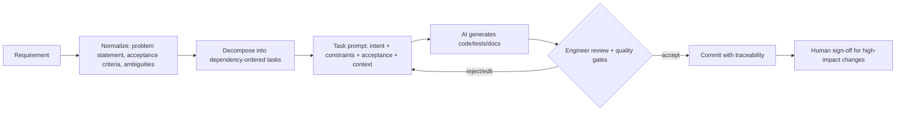

# AI-Assisted Engineering Approach

**Principle:** AI assists the engineer *within* tasks; the engineer owns scope, decisions, correctness, and
production readiness. Nothing generated by AI is merged without passing the quality gates and human review.

## 1. Workflow

1. **Normalize** the requirement (see [`SCENARIOS.md`](SCENARIOS.md)).
2. **Decompose** into small tasks with explicit dependencies.
3. **Prompt with structure** – every task prompt contains:
   - *Intent* – the user-visible outcome.
   - *Constraints* – layering rules (Core has no infrastructure deps), .NET 10 APIs, no new third-party packages
     without justification, nullable-clean, analyzers as errors.
   - *Acceptance criteria* – concrete, testable statements.
   - *Technical context* – relevant interfaces/files only (minimum necessary context).
4. **Iterate** – review output, run gates, refine the prompt with the specific failure (compiler error, failing test,
   reviewer objection) rather than re-asking from scratch.
5. **Record** generated / edited / rejected decisions in the traceability log below.

## 2. Where AI was used

| Activity | AI contribution | Engineer control (required before acceptance) |
|---|---|---|
| Requirement analysis | Draft ambiguity list and acceptance criteria | Confirm or change each decision; over-scoped items (geo-IP analytics, auth) were left out pending approval |
| Design | Proposed layering, component list, data model | Approve layering, lookup response (200 + URL), delete semantics and privacy scope |
| Implementation | Generated most production code | Review every file; options rejected during implementation are listed below |
| Debugging | Root-caused the intermittent drain-on-shutdown test failure | Root cause and fix verified with repeated test runs; review the fix |
| Test generation | Generated table-driven unit tests and integration tests | Review that tests assert behaviour; edge cases included (Linux `/path` → `file://`, subdomain blocking, concurrency races) |
| Documentation | Drafted README, scenarios, this document | Numbers and behaviours were checked against actual runs; review for accuracy |
| Review preparation | Self-review against the checklist below | Final sign-off by the repository owner (pending) |

## 3. Traceability log

> **Provenance:** this prototype was implemented by an AI coding agent (Devin) from `Requirement.docx`, working in a
> single session under the repository owner's direction. The log records the options the agent considered and
> rejected/edited during implementation (with rationale) and the one real defect found by the tests. The owner's
> review and sign-off (section 6) is the remaining human gate before any production use.

| # | Option considered | Outcome | Rationale |
|---|---|---|---|
| 1 | Layered solution (Core / Infrastructure / Api / tests) | **Accepted** | Testability and replaceable storage |
| 2 | Redirect using `301 Moved Permanently` | **Rejected → `302` + `no-cache`** (later superseded by #17) | `301` is cached by browsers; clicks and deactivation would be lost |
| 3 | Sequential integer IDs encoded to Base62 | **Rejected → CSPRNG codes** (`RandomNumberGenerator.GetString`) | Sequential codes are enumerable and leak volume |
| 4 | Hard delete endpoint | **Edited → soft delete, `410 Gone`** | Prevents code reuse; preserves analytics |
| 5 | `catch (DbUpdateException)` treated as duplicate code | **Edited → filter on `SqliteException` code 19** | Other failures must not be misreported as conflicts |
| 6 | URL validator relying on `Uri.TryCreate(..., Absolute)` | **Edited → explicit http/https allow-list + test** | On Linux `/path` parses as `file:///path` |
| 7 | Store client IP and full referrer for analytics | **Rejected → referrer host only, no IP** | Privacy by default; referrers can contain secrets |
| 8 | `BoundedChannelFullMode.DropWrite` | **Rejected → `Wait` + `TryWrite`** | `DropWrite` reports success while discarding, hiding data loss |
| 9 | Pass stopping token to batch persistence | **Rejected → `CancellationToken.None`** | Avoids losing an in-flight batch on shutdown |
| 10 | Drain buffer at end of `ExecuteAsync` | **Fixed → drain in `StopAsync` override** | Test showed `ExecuteAsync` may never run when stopped immediately |
| 11 | Read storage/rate-limit config during service registration | **Rejected → resolve `IOptions<T>` lazily** | Config overrides applied after registration (test hosts) were ignored |
| 12 | `DateTimeOffset` stored natively in SQLite | **Edited → `DateTimeOffsetToBinaryConverter`** | SQLite cannot translate comparisons/ordering on `DateTimeOffset` |
| 13 | Shared app-wide `IMemoryCache` with size limit | **Edited → dedicated bounded `MemoryCache`** | Global `SizeLimit` would break other cache users that don't set sizes |
| 14 | Mocking library for unit tests | **Rejected → hand-written fakes** | Fewer dependencies; fakes double as executable documentation |
| 15 | Route regex constraint for `{code}` | **Rejected → format check in service** | Escaping-heavy route regex was error-prone; service check also protects storage |
| 16 | Generated README sections | **Edited** | Numbers (tests, coverage) and behaviours verified against actual runs |
| 17 | Keep `302` redirect for `GET /{code}` when aligning with the reference repository | **Changed by owner → `200` + URL as JSON, `no-store`** | Owner chose the reference behaviour: the result is visible in Swagger and API clients |
| 18 | `EnsureCreated` at startup | **Replaced → EF Core migrations + `Database:AutoMigrate`** | Schema changes become reviewable and repeatable; pipelines can apply them instead |
| 19 | Keep an in-memory storage provider | **Removed from the app → test fakes only** | One production storage path; unit tests still use fast fakes |
| 20 | `400` for every invalid input | **Edited → `422` for readable-but-unacceptable input, `400` for unreadable bodies** | Lets clients tell malformed requests from rule violations |
| 21 | Store a truncated user-agent string | **Rejected → closed set of browser families** | A raw UA string helps fingerprinting; a family is enough for analytics |
| 22 | Fixed-window limit on writes | **Edited → token bucket** | No double burst across a window edge |
| 23 | Resolve DNS to block private targets | **Rejected → literal IP/host-name checks only** | DNS answers can change after the check (rebinding) and the service never fetches targets |

## 4. Quality gates applied to every AI output

| Gate | Tool | Enforced in |
|---|---|---|
| Static analysis / nullability | Roslyn analyzers, `TreatWarningsAsErrors`, `AnalysisLevel=latest` | Build (`Directory.Build.props`) |
| Style / formatting | `.editorconfig`, `dotnet format --verify-no-changes` | CI |
| Unit + integration tests | xUnit, `WebApplicationFactory`, SQLite | CI |
| Coverage | coverlet (Cobertura) | CI artifact |
| Dependency security | `dotnet list package --vulnerable --include-transitive` | CI |
| Configuration safety | `ValidateOnStart` option validation | App startup |
| Performance sanity | Hot path review: no DB write on lookup, cache-aside, cheap format check before I/O | Code review |
| Runtime smoke test | `dotnet run` + curl script, Docker build/run | Manual, before sign-off |

## 5. Secure AI usage

- No secrets, credentials, customer data, or internal hostnames are included in prompts; only the requirement and
  repository code are shared.
- AI output is treated as **untrusted code**: reviewed, compiled with analyzers as errors, and tested before use.
- New dependencies proposed by AI are accepted only from first-party/well-established sources (all packages here are
  Microsoft-published) and are scanned for known vulnerabilities.
- Security-relevant code (URL validation, rate limiting, error responses that could leak internals) gets line-by-line
  human review. Problem Details responses never include stack traces outside Development.
- Generated tests are reviewed to confirm they assert behaviour, not implementation details or tautologies.

## 6. Human sign-off checklist

High-impact changes require explicit approval by the owning engineer before release:

- [ ] **Public API contract** – routes (`/api/v1`), status codes, `code` values, response shapes.
- [ ] **Data model** – `short_links` / `click_events` schema, indexes, timestamp storage.
- [ ] **Security controls** – URL validation and private-network rules, denied hosts, rate limits, security headers, Swagger gating.
- [ ] **Privacy scope** – which click attributes are stored (currently: time, referrer host, browser family).
- [ ] **Irreversible decisions** – case-sensitive codes, `200`-with-URL lookup (no redirect), never reusing codes.
- [ ] **Operational defaults** – cache TTL, queue capacity, batch size, `BaseUrl` set for production.
- [ ] All quality gates green in CI.
- [ ] Known limitations accepted or ticketed (auth, durable analytics, URL reputation checks, multi-instance cache).

## 7. Ownership statement

The AI accelerated drafting, test generation, debugging and documentation. Architecture, trade-offs, security and
privacy decisions, and acceptance of every artifact remain the responsibility of the engineer, who reviews this
repository and completes the sign-off checklist above before any production use.
