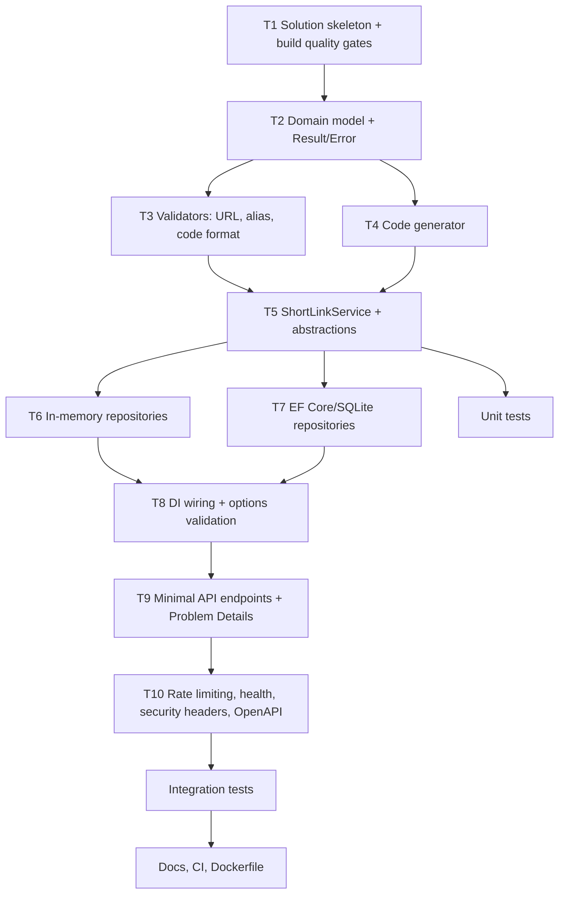

# Engineering Scenarios

Three scenarios exercised while building this service (the brownfield scenario is framed as a change request against the first-cut design; the defect described in it was real and found by the test suite). Each shows **decomposition → execution → validation**, the
files touched, and how AI was used under engineer control.

> **Update:** the service was later aligned with the owner's reference repository. `GET /{code}` now returns `200`
> with the original URL (no redirect), management routes live under `/api/v1/links`, and rule violations return `422`.
> The scenarios below use the current behaviour and test names.

- [Scenario 1 – Greenfield: URL shortener core](#scenario-1--greenfield-url-shortener-core)
- [Scenario 2 – Brownfield: analytics pipeline enhancement and shutdown bug fix](#scenario-2--brownfield-analytics-pipeline-enhancement-and-shutdown-bug-fix)
- [Scenario 3 – Ambiguous requirement](#scenario-3--ambiguous-requirement)

---

## Scenario 1 – Greenfield: URL shortener core

**Requirement (as given):** "Build a URL shortener service from scratch with core APIs, analytics, and reliability features."

### Normalized problem statement

Provide an HTTP service that (a) issues short, non-guessable codes for valid http(s) URLs, optionally with a custom
alias and expiry, (b) resolves codes to their targets with low latency, (c) exposes link management, and (d) records
click analytics without slowing lookups.

### Acceptance criteria

| ID | Criterion | Verified by |
|---|---|---|
| G1 | `POST /api/v1/links` returns `201` + `Location` with a 7-char Base62 code | `ShortLinkApiTests.Post_creates_a_link_and_returns_201_with_location` |
| G2 | Invalid or unsafe URLs return `422` Problem Details with `code` and `correlationId` | `Post_with_an_unacceptable_url_returns_422_problem_details`, `TargetUrlValidatorTests`, `UrlSafetyTests` |
| G3 | `GET /{code}` returns `200` with the target URL and `no-store` caching | `Lookup_returns_200_with_the_original_url_and_is_never_cached` |
| G4 | Unknown codes `404`; expired/deactivated `410` | `Lookup_for_an_unknown_code_returns_404`, `Deleted_links_return_410_...`, `Returns_gone_once_the_link_has_expired` |
| G5 | Custom aliases validated; duplicates `409` | `AliasValidatorTests`, `Post_with_a_taken_alias_returns_409` |
| G6 | Data survives restarts (SQLite) | `SqliteEndToEndTests`, `SqliteRepositoryTests` |
| G7 | Runnable end-to-end locally and in Docker | Manual smoke test (curl), `docker build` + `docker run` |

### Decomposition (dependency-ordered)

Each task was given to the AI assistant with **intent, constraints and acceptance criteria**, e.g. for T3:

> *Intent:* reject unsafe or unusable link targets. *Constraints:* pure function in Core, no I/O, no DNS lookups,
> configurable max length and blocked hosts; must block the service's own host. *Acceptance:* table-driven tests for
> each rejection reason, normalization of case/whitespace.

### Execution highlights

- `Directory.Build.props` turns warnings and analyzer findings into errors from the first commit, so AI-generated code
  must compile cleanly under nullable reference types.
- `ShortLinkService` (Core) contains all business rules and depends only on abstractions and `TimeProvider`, which made
  every rule testable with fakes and `FakeTimeProvider`.
- Several first-cut options were rejected during implementation (see the traceability log), notably `301` redirects,
  catching every `DbUpdateException` as a "conflict", and a validator that accepted `/relative/path` on Linux (it
  parses as `file:///relative/path`; the scheme allow-list now rejects it and a test pins the behaviour).

### Validation

- 153 unit tests + 43 integration tests green; `dotnet format` clean; no vulnerable packages.
- Manual smoke test against SQLite: create → lookup (`200`) → stats → delete → `410`, `/health`, `/openapi/v1.json`.
- Docker image built and exercised (`201`, `200`, `Healthy`).

---

## Scenario 2 – Brownfield: analytics pipeline enhancement and shutdown bug fix

**Change request:** "Clicks are recorded synchronously inside the redirect. Under load the redirect is slowed down by
database writes, and a slow database makes redirects fail. Make analytics non-blocking without losing clicks on a
normal deploy/restart."

### Codebase reasoning – impact analysis

| Area | Impact |
|---|---|
| `ShortLinkService.ResolveAsync` (Core) | Must stop awaiting a database write; depend on a fire-and-forget abstraction instead |
| `IClickEventRepository` (Core) | Move from per-click insert to `RecordBatchAsync` (insert events + increment counters in one transaction) |
| EF repositories (Infrastructure) and in-memory test fakes | Implement batch semantics; counters must not lose concurrent updates |
| Hosting (Infrastructure DI) | New singleton buffer + hosted background consumer; scoped `DbContext` must be created per batch |
| Stats endpoint (API) | Becomes eventually consistent – tests must poll instead of asserting immediately |
| Health (Infrastructure) | Surface dropped-event count so overload is observable |

Data flow before: `GET /{code}` → repository lookup → **insert click + update counter** → response.
Data flow after: `GET /{code}` → cache/repository lookup → `IClickTracker.TryTrack` (bounded channel) → `200`;
`ClickEventProcessor` → `RecordBatchAsync` asynchronously.

### Decomposition

1. Introduce `IClickTracker` in Core; `ResolveAsync` calls `TryTrack` and ignores the outcome (the lookup must succeed).
2. `ChannelClickTracker`: bounded channel, multi-writer/single-reader, drop + count when full.
3. `ClickEventProcessor : BackgroundService`: batch up to `BatchSize`, scope per batch, log-and-continue on failure.
4. `RecordBatchAsync` in EF (transaction + `ExecuteUpdateAsync` counter increment) and in-memory (CAS loop with `with`).
5. Graceful shutdown: persist what is still buffered.
6. Tests: overflow, batching, failure recovery, drain-on-shutdown; integration tests poll stats.

### Execution – including a real defect found by the tests

- **Rejected option:** `BoundedChannelFullMode.DropWrite`. With `DropWrite`, `TryWrite` returns `true` even
  though the item is discarded, so drops would be invisible. Switched to `FullMode.Wait` + `TryWrite` (returns `false`
  when full, never blocks) and an explicit drop counter.
- **Rejected option:** passing the stopping token into the batch write. Cancelling mid-write would discard an
  in-flight batch during shutdown; writes now use `CancellationToken.None` and only the *wait* honours cancellation.
- **Defect found:** the first implementation drained the buffer at the end of `ExecuteAsync`. The test
  `ClickPipelineTests.Processor_drains_buffered_events_on_shutdown` failed intermittently (`Expected: 500, Actual: 0`).
  Root cause: when the host stops right after starting, `BackgroundService` may never run `ExecuteAsync` (its start is
  scheduled with the already-cancelled token), so the drain code never executed. **Fix:** move draining into an
  override of `StopAsync`, executed after `base.StopAsync` and only when `ExecuteTask` is null or completed – which also
  guarantees the channel keeps a single reader if the host shutdown timeout elapses while a batch is still running.
  Verified by running the full suite repeatedly (5 consecutive green runs).

### Validation

- `ClickPipelineTests` (overflow, batching, drain on shutdown, recovery after failure).
- `InMemoryRepositoryTests.Concurrent_batches_do_not_lose_counter_updates`.
- `SqliteRepositoryTests.RecordBatch_persists_events_and_increments_counters`.
- `ShortLinkServiceResolveTests.Still_resolves_when_the_click_cannot_be_tracked`.
- `ShortLinkApiTests.Stats_reflect_lookups_asynchronously_and_store_only_host_and_browser_family` (polling assertion).

### Risk control

Analytics are now *at-most-once*: a hard crash loses buffered events and a failed batch is dropped. This is a
deliberate trade-off (lookup availability over analytics completeness), documented in the README; the upgrade path
is an outbox table or a message broker for at-least-once delivery.

---

## Scenario 3 – Ambiguous requirement

**Requirement (as given):** "…core APIs, analytics, and reliability features."
None of *analytics*, *reliability*, *delete*, or *duplicate handling* is specified.

### Identified ambiguities and decisions

| Ambiguity | Options considered | Decision | Rationale | Reversible? |
|---|---|---|---|---|
| What analytics? | Raw click log; counters; geo/device breakdown | Total clicks, last access, daily series (UTC), top referrer hosts | Answers the common questions without collecting personal data | Yes – events are stored, new aggregations can be added |
| What personal data to collect? | IP, full referrer URL, full UA | Referrer **host** only, UA truncated to 512 chars, **no IP** | Privacy by default (GDPR-friendly); full referrers can contain tokens | Partially – data not collected cannot be backfilled |
| Must analytics be exact and immediate? | Synchronous exact counts; async best-effort | Async, eventually consistent, best-effort under overload | Lookup latency/availability is the primary SLO | Yes – swap `IClickTracker` implementation |
| How should `GET /{code}` answer? | `301`/`302`/`307`/`308` redirect, or `200` with the URL | `200` + URL as JSON, `no-store` (owner decision, matches the reference repository) | Visible in Swagger and API clients; every lookup is counted; deactivation is immediate | Yes – a redirect could be added later as a separate route; `301`s are never issued, so nothing is stuck in client caches |
| What does "delete" mean? | Hard delete; soft delete | Soft delete → `410 Gone`, code never reused | Prevents old shared links pointing to new destinations; keeps history | Yes |
| Same URL shortened twice? | Always new code; always reuse | Reuse only generated, active, non-expiring links | Avoids code waste while respecting alias/expiry intent | Yes – `Shortener:DeduplicateUrls` |
| What does "reliability" mean? | HA cluster; retries; limits | Rate limiting, health check, input validation, bounded queues, cache, graceful drain, fail-fast config | Achievable in a prototype; each item tested | Yes |
| Case sensitivity of codes | Case-insensitive; case-sensitive | Case-sensitive Base62 | Larger keyspace; matches common shorteners | Costly after launch – decided early |
| Authentication | API keys; OAuth; none | None in prototype, flagged as a limitation | Out of scope; would be fronted by a gateway | Yes |

### Decomposition

1. Write the ambiguity table above and pick the least-surprising, reversible option for each item.
2. Encode each decision as configuration where reasonable (`DeduplicateUrls`, cache TTL, limits, blocked hosts).
3. Encode each decision as a test so it cannot drift silently (e.g. `Does_not_reuse_deactivated_or_expiring_links`,
   `Normalizes_referrers_to_their_host_only`, `Lookup_returns_200_with_the_original_url_and_is_never_cached`).
4. Document assumptions and limitations in the README for stakeholder review.

### Validation

Every decision above maps to at least one automated test or a configuration key with startup validation. Decisions
that are hard to reverse (privacy scope, case sensitivity, lookup semantics) are flagged for explicit human sign-off in
[`AI_ASSISTED_ENGINEERING.md`](AI_ASSISTED_ENGINEERING.md#human-sign-off-checklist).
